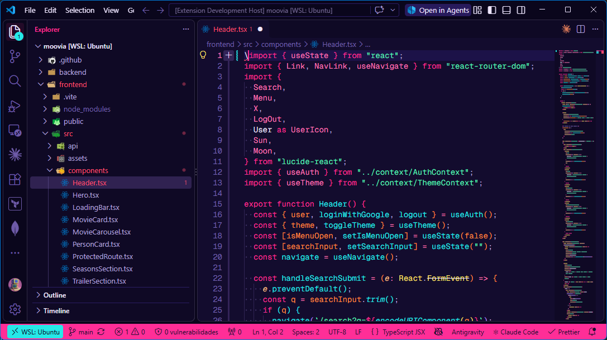
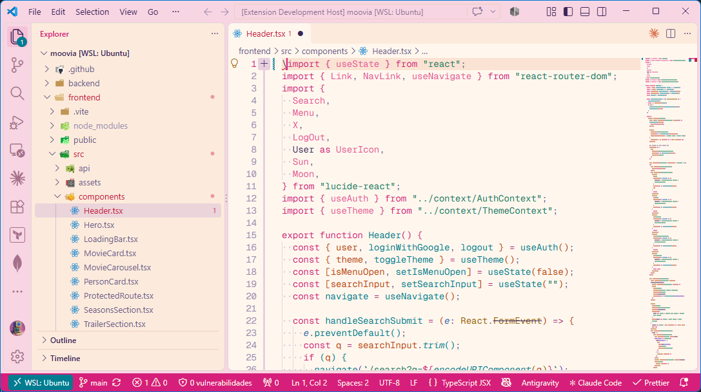

# Vice Hour

Dois temas para VS Code no estilo Vice City: atmosfera tropical de Miami, neon rosa e ciano, tons pastéis quentes, palmeiras, pores do sol intensos e a pegada retrô-urbana dos anos 80.

Tema de fã, não oficial. Sem vínculo com a Rockstar Games ou a Take-Two Interactive.

## Temas

### Vice Hour Neon Nights (escuro)

A cidade depois do pôr do sol: céu índigo profundo, letreiros de neon e a barra de status em rosa choque.



| Papel | Cor |
| --- | --- |
| Fundo do editor | `#130C2E` |
| Texto | `#EEE6FF` |
| Keywords, tags | `#FF2E97` rosa neon |
| Funções | `#25E8E8` ciano neon |
| Strings | `#5CF2B8` menta |
| Números e constantes | `#FF8A3D` laranja do pôr do sol |
| Tipos e classes | `#FFE066` amarelo |
| Propriedades | `#B388FF` lavanda |
| Parâmetros | `#FFC08A` pêssego |

### Vice Hour Miami Day (claro)

A Ocean Drive de dia: fundo creme de areia, painéis em pêssego e rosa pastel, sintaxe em rosa quente, azul-petróleo e verde de palmeira.



| Papel | Cor |
| --- | --- |
| Fundo do editor | `#FFF7EE` |
| Texto | `#3A2559` |
| Keywords, tags | `#D61F7A` rosa quente |
| Funções | `#007C91` azul-petróleo |
| Strings | `#15805A` verde palmeira |
| Números e constantes | `#C2410C` laranja queimado |
| Tipos e classes | `#9A6200` ocre |
| Propriedades | `#7433CC` violeta |
| Parâmetros | `#2A6BB0` azul oceano |

## Testar localmente

1. Abra esta pasta no VS Code.
2. Pressione `F5` para abrir uma janela de Extension Development Host.
3. `Ctrl+K Ctrl+T` e escolha **Vice Hour Neon Nights** ou **Vice Hour Miami Day**.

## Instalar

```bash
npx @vscode/vsce package
code --install-extension vice-hour-1.0.0.vsix
```
